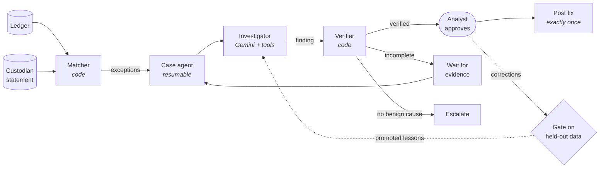

# Continuum

**Durable, verifiable, self-improving agents on Google ADK.**

[](https://github.com/MythriP/continuum/actions/workflows/ci.yml)


Continuum is a framework for LLM agents that do operational work where
mistakes are costly. Tasks pause for days and survive crashes. Actions happen
exactly once. Every answer is checked by code before a human sees it. Human
corrections become rules only after they are proven on held-out data.

It ships with a complete reference application, **reconcile**: daily
reconciliation of an asset manager's ledger against its custodian's
statements, from matching through investigation, approval and posting.

> All data is synthetic. No real firm, client or bank data is used, and the
> application does not connect to any bank or move money.

---

## Capabilities

| Capability | What it means |
|---|---|
| **Durable cases** | a case can wait days for evidence, then resume exactly where it stopped, even after a crash (ADK resumable agents) |
| **Exactly-once actions** | a fix is posted once, enforced by database constraints and tested by killing the process mid-post |
| **Code-verified answers** | the agent's claimed cause is recomputed from reference data; a plausible but false explanation is rejected |
| **Maker-checker** | agents propose, named humans approve; reject and correct require a reason |
| **Append-only audit trail** | every event is recorded and cannot be edited or deleted |
| **Gated learning** | analyst corrections become lessons only if they reduce failures on held-out data without lowering accuracy, and a human approves |
| **Reproducible evaluation** | every model answer is cached by input hash; any run re-scores with zero model calls |

---

## How it works



1. **Match** (code): ledger and custodian lines are paired exactly; every
   difference opens a case.
2. **Investigate** (agent): a Gemini agent gathers evidence with nine tools and
   proposes a typed finding: cause, fix, amount.
3. **Verify** (code): the claimed cause must reproduce the break exactly from
   commission schedules, FX rates, market calendars and tax tables.
4. **Wait** (durable): if evidence is still to come, the case stops and resumes
   when it arrives.
5. **Approve** (human): a named analyst approves, rejects or corrects.
6. **Post** (exactly once): the fix is applied once, whatever fails in between.
7. **Learn** (gated): corrections are tested on held-out data before the agent
   ever sees them.

Full component, data-flow, sequence, state, storage and deployment diagrams:
**[docs/architecture.md](docs/architecture.md)**.

---

## Quick start

Requires Python 3.12+.

```bash
git clone https://github.com/MythriP/continuum.git
cd continuum
python -m venv .venv && source .venv/bin/activate
make install          # pip install -e ".[dev]"
make test             # full offline suite: no API key, no cost
make demo             # one simulated day with a scripted investigator
```

### Work a day of cases (offline)

`--oracle` uses a scripted investigator in place of the model; its answers
still pass through the verifier.

```bash
reconcile init                              # open day 1
reconcile work --oracle                     # investigate and verify every case
reconcile board                             # cases by status
reconcile show 1124-X003                    # one case in detail
reconcile approve 1124-X003 --by YOUR_NAME  # maker-checker approval
reconcile work --oracle                     # post the approved fix
reconcile audit 1124-X003                   # full audit trail
reconcile advance                           # next statement day
```

### With the real model

```bash
cp .env.example .env        # add your GOOGLE_API_KEY
reconcile work              # investigates with Gemini (paid API calls)
```

### In a container

```bash
make docker
docker compose -f deploy/compose.yaml run --rm reconcile init
docker compose -f deploy/compose.yaml run --rm reconcile work --oracle
```

---

## Evaluation

The framework is evaluated by code against ground truth; no model grades
another model.

| Suite | Command | Measures |
|---|---|---|
| Offline tests | `make test` | durability, matching, verification, workflow controls, exactly-once under process kill, learning gate |
| Investigation benchmark | `python -m reconcile.evals.benchmark` | resolution accuracy, escalation of real errors, false explanations attempted and passed |
| Learning evaluation | `python -m reconcile.evals.learning run A\|C` | false explanations under analyst pressure, with and without a lesson, on a held-out day |

Method, metrics and the promotion gate: **[docs/evaluation.md](docs/evaluation.md)**.

---

## Repository layout

```
continuum/
├── src/
│   ├── continuum/              framework
│   │   ├── config.py           runtime locations and settings
│   │   ├── llm.py              retry, quota handling, model fallback, test model
│   │   └── replay.py           answer cache by input hash; cache-only mode
│   └── reconcile/              reference application
│       ├── cli.py              analyst command line (`reconcile`)
│       ├── ops.py              day operations: open, advance, work
│       ├── case.py             resumable case agent
│       ├── store.py            case store: audit, decisions, postings
│       ├── match.py            exact matching
│       ├── agents.py           investigator agent and finding schema
│       ├── evidence.py         the investigator's tools
│       ├── verify.py           code checks for every cause
│       ├── lessons.py          promoted lessons (lessons.md)
│       ├── refdata.py          securities, brokers, FX, calendars, tax rates
│       ├── policy.json         tolerance policy
│       ├── oracle.py           scripted investigator for tests and demos
│       ├── data/generate.py    seeded synthetic data and ground truth
│       └── evals/              benchmark and learning evaluation
├── data/reconcile/             synthetic dataset
├── tests/                      offline test suite
├── spikes/                     feasibility proofs for the ADK features relied on
├── docs/                       architecture and evaluation
├── deploy/compose.yaml         container job definition
├── .github/workflows/ci.yml    lint and tests on every push
├── Dockerfile
├── Makefile
├── pyproject.toml
└── .env.example
```

Runtime state (case store, ADK sessions, replay cache, evaluation results) is
written to `var/`, which is not committed.

---

## Configuration

| Variable | Purpose | Default |
|---|---|---|
| `GOOGLE_API_KEY` | Gemini API key; only needed for real-model runs | none |
| `CONTINUUM_MODEL` | investigator model | `gemini-3.5-flash` |
| `CONTINUUM_HOME` | base folder | working directory |
| `CONTINUUM_VAR` | runtime state | `$CONTINUUM_HOME/var` |
| `RECONCILE_DATA` | dataset location | `$CONTINUUM_HOME/data/reconcile` |

---

## Design principles

- **Code decides correctness.** A model judge can be persuaded by a plausible
  but false explanation, so every finding is recomputed by code.
- **Guarantees live in the database.** Exactly-once posting and the immutable
  audit trail are constraints, not conventions.
- **Agents propose; humans approve.**
- **Learning is gated.** Nothing changes the agent's behaviour on faith.
- **Simple infrastructure.** SQLite and plain files; no servers to operate.

## Limitations

- Synthetic data; single process; one model family.
- Case ageing is configured but not yet implemented.
- ADK resumability is experimental upstream; `google-adk` is pinned to 2.11.0.

See [docs/architecture.md](docs/architecture.md#14-known-limitations).
