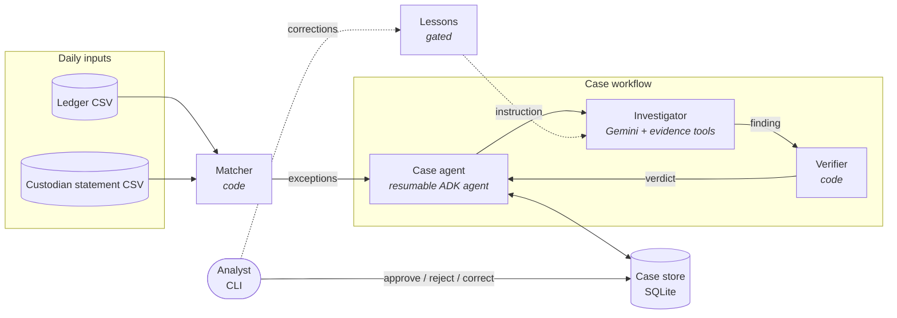
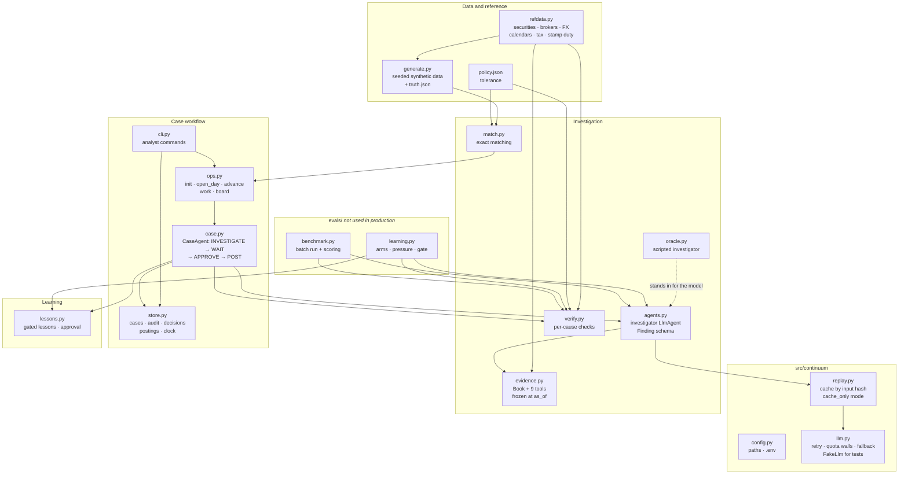
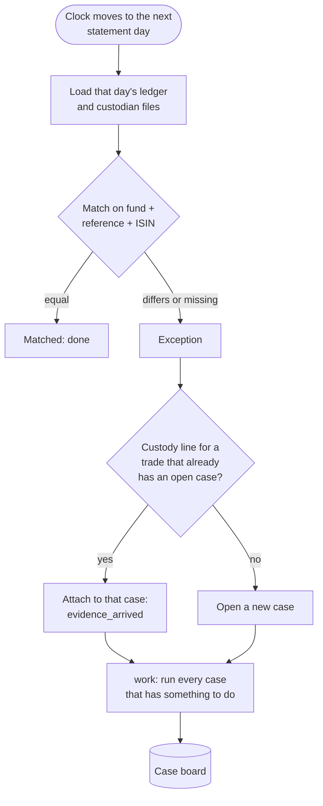
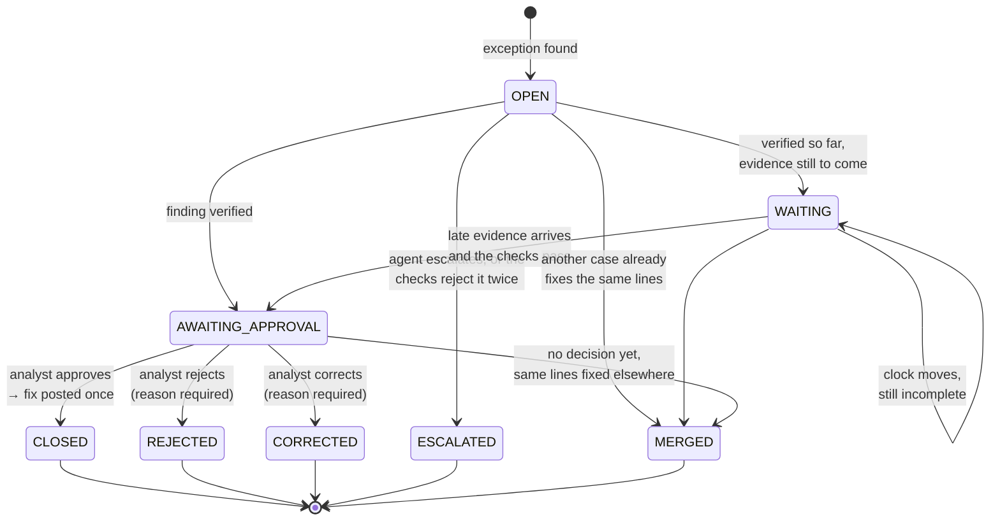
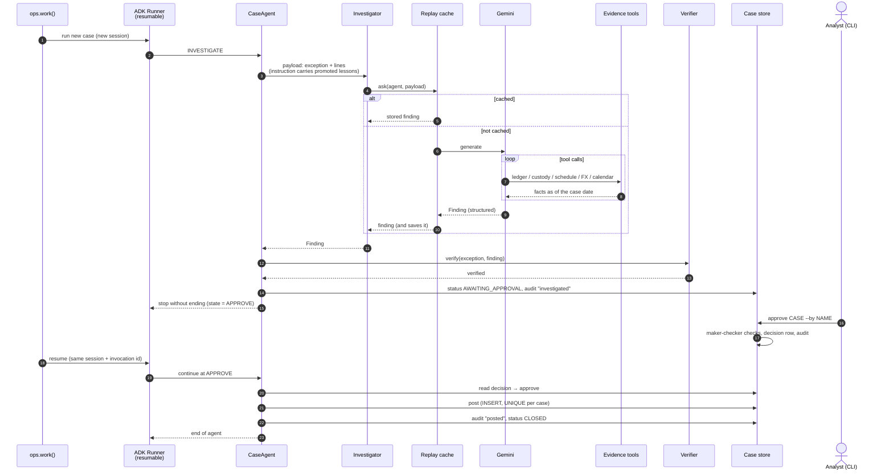
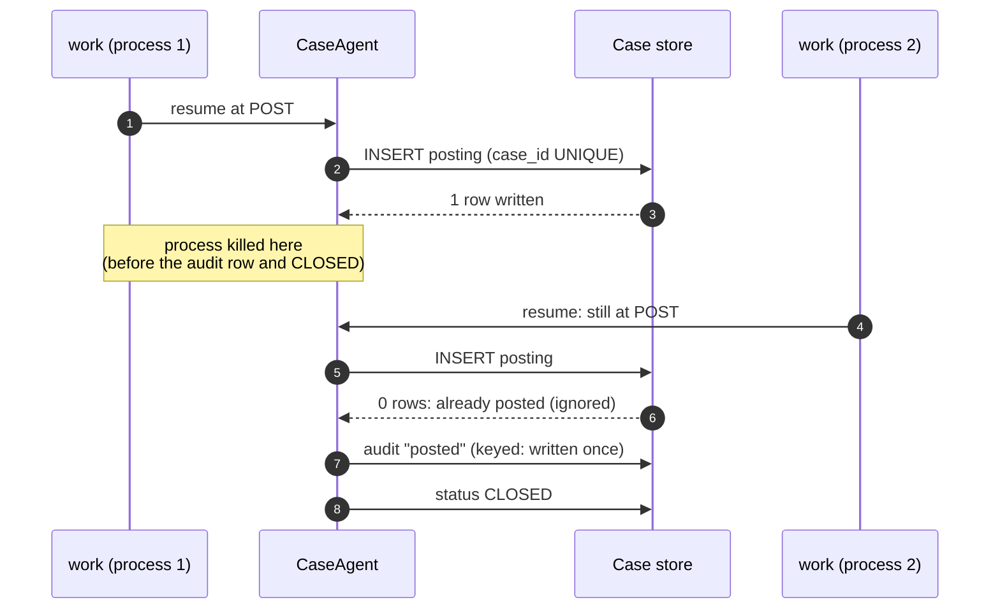
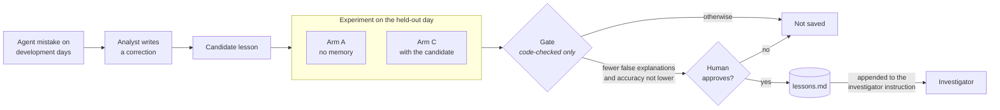
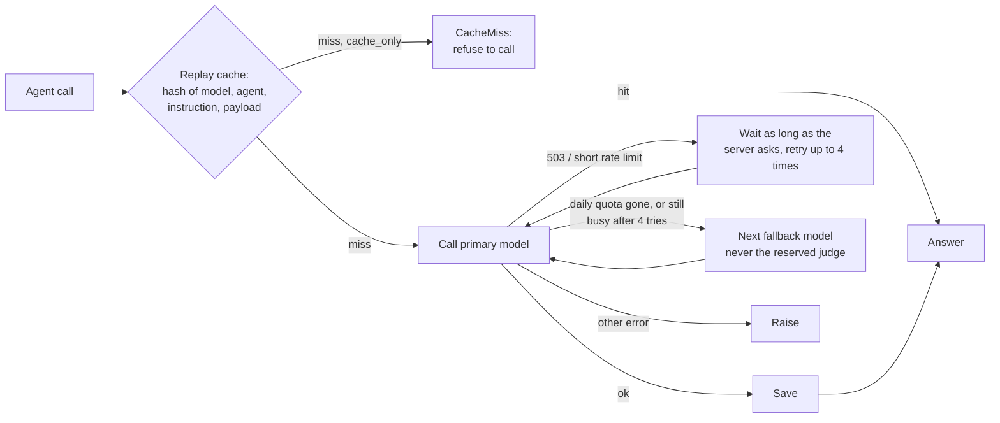
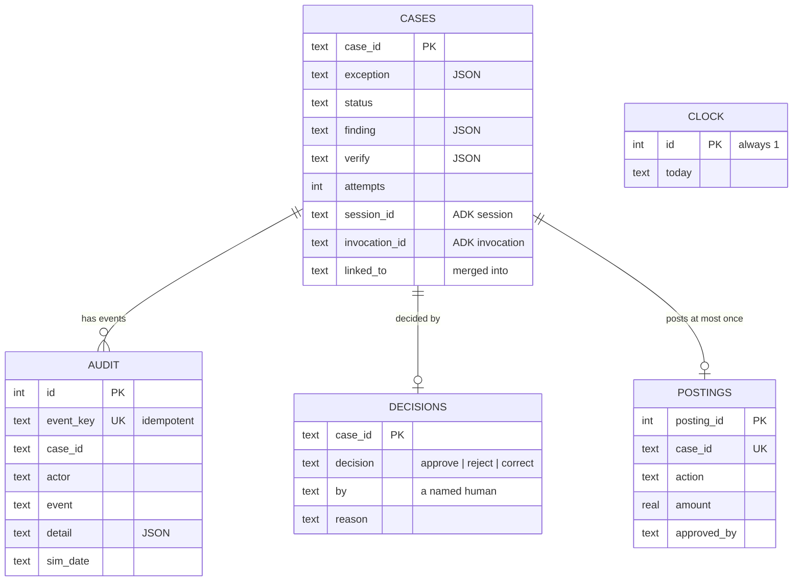
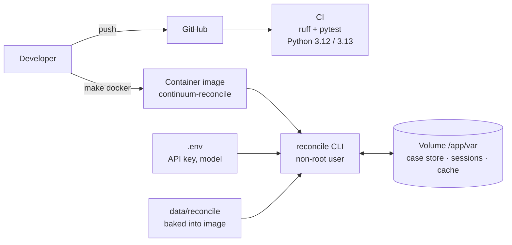

# Architecture

This document describes how Continuum and its reference application,
**reconcile**, are put together: the components, how data moves between them,
how a case survives crashes and long waits, how the system learns, and why it
is designed this way.

- [1. System overview](#1-system-overview)
- [2. Components](#2-components)
- [3. Daily data flow](#3-daily-data-flow)
- [4. Case lifecycle](#4-case-lifecycle)
- [5. Running a case: component interaction](#5-running-a-case-component-interaction)
- [6. Durability and exactly-once posting](#6-durability-and-exactly-once-posting)
- [7. Correctness: code decides, not a model](#7-correctness-code-decides-not-a-model)
- [8. Learning loop](#8-learning-loop)
- [9. Model access](#9-model-access)
- [10. Storage](#10-storage)
- [11. Synthetic data](#11-synthetic-data)
- [12. Deployment and configuration](#12-deployment-and-configuration)
- [13. Design decisions](#13-design-decisions)
- [14. Known limitations](#14-known-limitations)

---

## 1. System overview

Continuum is a small framework of patterns for agents that must be **durable**
(a task can pause for days and survive a crash), **safe** (nothing irreversible
happens without a checked reason and a human's approval) and **able to learn**
(human corrections become rules, but only after they are tested).

It is built on [Google ADK](https://google.github.io/adk-docs/). The reference
application reconciles a fictional asset manager's ledger against its
custodian's daily statements.

| Layer | Package | Responsibility |
|---|---|---|
| Framework | `src/continuum/` | configuration; model access with retry, quota handling and fallback; a replay cache that makes every run reproducible |
| Application | `src/reconcile/` | data generation, matching, evidence, investigator, verifier, case workflow, lessons |
| Evaluation | `src/reconcile/evals/` | investigation benchmark and learning evaluation; never imported by production code |
| Dataset | `data/reconcile/` | the generated synthetic ledger, custodian statements and ground truth |
| Feasibility spikes | `spikes/` | minimal proofs of two ADK behaviours the design depends on |

---

## 2. Components

| Component | File | What it does | Talks to |
|---|---|---|---|
| Data generator | `data/generate.py` | writes ledger and custodian CSVs per day from a seed, injects known breaks, records the true cause of each in `truth.json` | `refdata` |
| Reference data | `refdata.py` | fictional securities with valid ISINs, broker commission schedules, FX rates, market calendars (T+1 US, T+2 EU/UK, 2026 holidays), withholding and stamp duty rates | used by generator, evidence, verifier |
| Matcher | `match.py` | pairs ledger and custody lines on fund, normalised reference and ISIN; anything not equal on quantity, cash (within tolerance) and date becomes an **exception** | `ops` |
| Evidence | `evidence.py` | the investigator's 9 tools (ledger and custody lookups, security, commission schedule, FX rate, calendar, withholding). Each tool only sees statements dated on or before the case's `as_of` | investigator |
| Investigator | `agents.py` | an ADK `LlmAgent` that calls the tools and returns one typed `Finding`: cause, action, amount, evidence | `replay` → `llm` → Gemini |
| Verifier | `verify.py` | recomputes the claimed cause from reference data; returns `verified`, `pending`, `escalated` or `rejected` | `refdata`, `evidence` |
| Case agent | `case.py` | one resumable ADK agent per case; steps INVESTIGATE → WAIT → APPROVE → POST; stops cleanly while waiting | investigator, verifier, store |
| Operations | `ops.py` | opens a day's cases, moves the simulated clock, starts or resumes every case that has work to do | matcher, case agent, store |
| Case store | `store.py` | SQLite: cases, append-only audit trail, decisions, postings, clock | everything in the workflow |
| Analyst CLI | `cli.py` | `init`, `work`, `advance`, `board`, `show`, `approve`, `reject`, `correct`, `audit` | ops, store |
| Oracle | `oracle.py` | answers from `truth.json` instead of a model; for offline tests and demos. Its findings still go through the verifier | case agent, batch run |
| Lessons | `lessons.py`, `lessons.md` | promoted lessons; the case agent passes them to the investigator on every run. Saving requires explicit human approval | case agent, learning evaluation |
| Configuration | `continuum/config.py` | runtime locations and `.env` loading, all overridable by environment variables | every module that reads or writes files |
| Benchmark | `evals/benchmark.py` | investigates every exception at once and scores against the truth | investigator, verifier |
| Learning evaluation | `evals/learning.py` | runs arms on held-out data under pressure and applies the promotion gate | investigator, verifier, lessons |

---

## 3. Daily data flow

1. `ops.advance()` moves the simulated clock to the next statement day.
2. `ops.open_day()` matches that day's files. Each exception opens a case,
   except a late leg of a partial settlement, which is attached to the case
   already waiting for it.
3. `ops.work()` starts new cases and resumes waiting or approved ones. Cases
   with nothing new (awaiting an analyst) are skipped without a model call.

---

## 4. Case lifecycle

| Status | Meaning | Who moves it on |
|---|---|---|
| `OPEN` | new, not yet investigated | `work` |
| `WAITING` | the cause is consistent but evidence is still to come (e.g. the rest of a partial settlement) | the clock moving on |
| `AWAITING_APPROVAL` | the verifier accepted the fix | a named analyst |
| `ESCALATED` | no benign cause reproduces the break; a human takes it. Nothing posts | (terminal) |
| `CLOSED` | approved and posted exactly once | (terminal) |
| `REJECTED`, `CORRECTED` | the analyst disagreed, with a reason; corrections feed the learning loop | (terminal) |
| `MERGED` | the same lines are already being fixed by another case (e.g. both sides of a reference mismatch) | (terminal) |

A rejected finding gets **one** more attempt, with the verifier's reason
added to the prompt. A second rejection escalates.

---

## 5. Running a case: component interaction

The case agent keeps only **which step it is on** in ADK agent state. Every
fact it acts on (the finding, the decision, whether it already posted) is
re-read from the case store when it resumes, so a resumed run never trusts its
own memory.

---

## 6. Durability and exactly-once posting

Waiting is **not** a scheduler. A case simply returns without ending. ADK
stores its session and agent state in `sessions.db`; `work` resumes it later
with the same session and invocation id.

Three guarantees are enforced by the database, not by convention:

| Guarantee | Mechanism |
|---|---|
| A case posts at most once | `postings.case_id` is `UNIQUE`; the insert is `INSERT OR IGNORE` |
| An audit event is recorded once, even if a step re-runs | each event has a deterministic `event_key` with a `UNIQUE` constraint |
| The audit trail cannot be changed | `BEFORE UPDATE` and `BEFORE DELETE` triggers abort |

The test suite kills real subprocesses (`os._exit`) right after the posting
row is written and checks that resuming leaves exactly one posting and one
`posted` audit row. With the `UNIQUE` guard removed, the same test fails with
a double posting.

---

## 7. Correctness: code decides, not a model

A fix equal to the gap always balances, so "does it balance?" proves nothing.
For the cause the agent claims, the verifier recomputes what that cause would
produce from reference data, and accepts only an exact reproduction.

| Claimed cause | What the verifier recomputes |
|---|---|
| Commission netted | broker schedule commission for this quantity, converted at the settle-date rate |
| FX rate date | the trade-date vs settle-date conversion of the net amount |
| Commission + FX together | both at once; neither alone may explain it |
| Settlement date | the market calendar date (T+1 US, T+2 EU/UK, holidays) |
| Partial settlement | the legs received so far: cash per share consistent; total quantity complete → `verified`, incomplete → `pending` |
| Duplicate booking | an identical twin ledger line, and a single custodian settlement |
| Reference mismatch | same fund, security, quantity, cash and date; references are a transposition; **no other trade fits equally** |
| Dividend withholding | the country's withholding rate on the gross dividend |
| Stamp duty | 0.5% of the consideration on a UK purchase |
| Escalate | always accepted: a human decides, nothing posts |

Every agent answer passes through the verifier before any human sees it.
Only sub-cent rounding is tolerated (`policy.json`).

---

## 8. Learning loop

| Rule | Why |
|---|---|
| Lessons come from development days; the gate runs on a **held-out** day | a lesson must generalise, not memorise the cases it came from |
| Both arms run under **pressure** (an analyst suggesting a plausible wrong cause) | that is when the failure appears; first answers rarely contain it |
| The gate uses **only code-checked numbers**: false-explanation attempts, and accuracy on genuine breaks | a model judge rewards the plausible false explanation the lesson is meant to remove |
| Accuracy on genuine breaks may not drop by more than 5% | otherwise "escalate anything odd" would pass as an improvement |
| Saving needs explicit human approval (`apply(..., approved=True)`) | nothing changes the agent's behaviour on faith |
| Evidence is kept in `lessons.md` as a comment the agent does not see | the agent receives exactly the text the gate tested |

---

## 9. Model access

- **Replay cache:** every answer is stored by a hash of its inputs, so results
  can be re-scored with zero model calls, and `cache_only=True` makes accidental
  paid calls impossible.
- **Retry:** transient errors wait for the server's suggested delay; a daily
  quota wall is never retried.
- **Reserved model:** a stronger model is kept for any judge or reviewer and
  never used as a fallback, so its quota is not spent by other agents.
- **Usage counter:** requests and tokens per run, for cost reporting.
- **Tests** use `FakeLlm` and the oracle: no network, no cost.

---

## 10. Storage

All runtime state lives in plain local files under `var/` (git-ignored; `CONTINUUM_VAR` to move it).

| File | Contents |
|---|---|
| `var/reconcile.db` | case store (below) |
| `var/sessions.db` | ADK sessions and agent state, which is what makes cases resumable |
| `var/replay/*.json` | cached model answers |
| `var/evals/` | benchmark and learning-evaluation results |

---

## 11. Synthetic data

A seeded generator writes the same files on every run: 3 trade dates in
Thanksgiving week 2026, about 150 trades a day across 4 funds (US large cap,
US small cap, global equity, income), plus late custodian statements for
partial settlements. Securities are fictional issuers with valid-format ISINs;
rates and fees are synthetic.

| Break type | What differs | Right answer |
|---|---|---|
| Commission netted | ledger gross, custodian net of commission | adjust commission |
| FX rate date | trade-date vs settle-date FX conversion | adjust FX |
| Settlement date | naive T+1 across a holiday, or T+1 on a T+2 market | correct the date |
| Partial settlement | custodian settles part now, the rest later | wait, then merge |
| Duplicate booking | ledger has the trade twice | cancel the copy |
| Reference mismatch | custodian's reference has two digits swapped | link the lines |
| Dividend withholding | ledger gross, custodian net of tax | adjust tax |
| **Real booking error (decoy)** | wrong quantity or price; no benign explanation exists | **escalate** |
| Two causes on one trade | commission netted and trade-date FX | both causes |
| Ambiguous reference | swapped reference equals another real trade's | link by cash, not by reference |
| Near-miss fee | commission a few cents off the schedule | escalate (broker dispute) |
| Subtle errors | quantity one lot off; price one cent off | escalate |
| Stamp duty | UK purchase without 0.5% stamp duty | adjust stamp duty |

Days 1 and 2 are for development and lessons; **day 3 is held out** for the
learning test.

---

## 12. Deployment and configuration

| Concern | How it is handled |
|---|---|
| Packaging | `pyproject.toml`; installs the `continuum` and `reconcile` packages and a `reconcile` command |
| Container | `Dockerfile`: slim Python image, non-root user, state in a volume at `/app/var` |
| Orchestration | `deploy/compose.yaml` runs the job with the volume and `.env`; a scheduler (cron, a CI job, a cloud job runner) can call `reconcile work` each day |
| Continuous integration | `.github/workflows/ci.yml`: lint and the full offline test suite on every push |
| Secrets | `GOOGLE_API_KEY` from the environment or `.env`; never committed (`.env.example` lists the settings) |
| Configuration | `CONTINUUM_HOME`, `CONTINUUM_VAR`, `RECONCILE_DATA`, `CONTINUUM_MODEL` |
| Lessons in production | read from the installed package; new lessons are promoted in development and shipped with a release |

---

## 13. Design decisions

| # | Decision | Alternatives considered | Why |
|---|---|---|---|
| 1 | **Code verifies every finding** by recomputing the cause | a reviewer model; a balance check | a reviewer model can be convinced by a plausible lie; a balance check accepts any fix the size of the gap |
| 2 | **Waiting is ADK agent state**; a case returns without ending and is resumed later | a separate scheduler and state machine | one source of truth for where a case is; proven first in a spike |
| 3 | **SQLite and plain files** | a database server, a queue | enough for the scale; nothing to operate; easy to inspect |
| 4 | **Exactly-once in the database** (`UNIQUE`, keyed audit events) | checking in application code | survives a crash between any two lines |
| 5 | **Re-read facts from the store on resume**; agent state holds only the step | keep the finding and decision in agent state | a resumed run never acts on stale memory |
| 6 | **Maker-checker** enforced in `store.decide` | trust the caller | an agent name cannot approve; reject and correct need a reason; only `AWAITING_APPROVAL` cases can be decided, once |
| 7 | **Append-only audit by triggers** | a policy in code | the database refuses edits from any client |
| 8 | **One fix per set of lines** (merge sibling cases) | dedupe at posting | the analyst sees one case, not two copies of the same fix |
| 9 | **Replay cache with `cache_only`** | re-run the model when re-scoring | reproducible numbers, no accidental spend |
| 10 | **Scripted oracle** for tests and demos, still passing the verifier | mocking the verifier | the safety path is exercised in every offline test |
| 11 | **Held-out day, code-only gate, human approval** for lessons | promote on a judge score | prevents memorised, unverified or reward-hacked lessons |
| 12 | **Lessons as plain text** in the instruction | fine-tuning; retrieval of raw past cases | auditable, reversible, and the exact tested text is what the agent sees |
| 13 | **Synthetic data with a truth file** | real data | correctness is checkable by code; no confidential data |
| 14 | **Evaluation code separate from production** (`evals/`) | experiments alongside the workflow | production never imports experiment code; the deployable package stays small and auditable |

---

## 14. Known limitations

- **Single process, sequential cases.** `work` runs cases one after another; no
  locking for concurrent workers.
- **Case ageing** (`escalate_after_business_days` in `policy.json`) is
  configured but not implemented.
- **Learning evaluation scale.** The held-out set is one simulated day; broader
  datasets and more repetitions are needed before results generalise. See
  [evaluation.md](evaluation.md).
- **One model family** (Gemini). A reviewer-model comparison is not yet measured.
- **ADK resumability is marked experimental**; `google-adk` is pinned to 2.11.0.
- **Posting** writes a row to a local table; there is no ledger system behind it.
