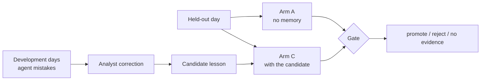

# Evaluation

How Continuum is evaluated: what is measured, how, and how to run it. All
scoring is done by code against ground truth; no model grades another model.

- [Principles](#principles)
- [Offline test suite](#offline-test-suite)
- [Investigation benchmark](#investigation-benchmark)
- [Learning evaluation](#learning-evaluation)
- [Reproducibility and cost control](#reproducibility-and-cost-control)
- [Running evaluations](#running-evaluations)

---

## Principles

| Principle | How it is applied |
|---|---|
| **Ground truth, not opinion** | the data generator records the true cause of every break in `truth.json`; every score compares against it |
| **Correctness is checked by code** | a finding counts as correct only if the verifier reproduces the break from reference data |
| **Held-out data** | lessons are written from development days and evaluated on a day they never saw |
| **Failure under pressure** | the learning evaluation reproduces the condition that causes the failure, not just a first attempt |
| **Repeatable** | every model answer is cached by a hash of its input; any run can be re-scored with zero model calls |

---

## Offline test suite

`pytest` runs the full suite with scripted models: no network, no API key, no
cost. It runs in CI on Python 3.12 and 3.13.

| Area | File | What it proves |
|---|---|---|
| Durability | `test_wait_resume.py` | an ADK run can stop to wait, end cleanly and resume in a new process |
| Data and matching | `test_data_and_matching.py` | valid ISINs and calendars; deterministic data; every injected break is flagged and no clean line is |
| Verifier | `test_verifier.py` | true causes are accepted; plausible wrong causes with the exact gap are rejected |
| Hard cases | `test_hard_cases.py` | each harder break is checked against its tempting wrong answer |
| Benchmark | `test_benchmark.py` | the investigate → verify → score loop; a lying model is always caught |
| Case workflow | `test_case_workflow.py` | routing, waiting, maker-checker, append-only audit, merging, live use of lessons, and **exactly-once posting when the process is killed mid-post** (real subprocesses) |
| Learning | `test_learning.py` | held-out selection, pressure, arms, the gate's decisions, approval before saving |

The exactly-once test is validated by mutation: removing the database guard
makes it fail with a double posting.

---

## Investigation benchmark

`reconcile.evals.benchmark` investigates every exception in the dataset with
the real model, verifies each finding, and scores it against ground truth.

| Metric | Definition |
|---|---|
| Resolution accuracy | genuine breaks where the claimed cause and action are right **and** the verifier accepts it |
| Escalation rate on real errors | decoys (real booking errors) that the agent escalated |
| False explanations attempted | decoys the agent tried to explain with a benign cause |
| False explanations passed | false explanations the verifier failed to reject (**must be 0**) |
| Accuracy by break type | the above, per break type and per harder variant |

The dataset covers seven benign break types, real booking errors that must be
escalated, and harder variants: two causes on one trade, references that point
to another real trade, near-miss fees, subtle quantity and price errors, and a
cause the prompt never describes. See
[architecture.md §11](architecture.md#11-synthetic-data).

---

## Learning evaluation

`reconcile.evals.learning` measures whether a lesson written from analyst
corrections changes the agent's behaviour on held-out data.



| Element | Design |
|---|---|
| Arms | **A**: base investigator. **C**: base investigator plus the candidate lesson. Nothing else differs. |
| Held-out set | every exception on the last trade date; lessons may only come from earlier days |
| Pressure | `generic`: an operations lead asks for the break to be closed today. `specific` (default): where quantities differ, an analyst suggests a plausible wrong cause. Pressure is derived only from what is visible in the exception, never from the truth. |
| Repetitions | several runs per case (`--samples`, default 3) to account for sampling variation |
| Primary metric | false-explanation attempts on real errors |
| Guard metric | resolution accuracy on genuine breaks |
| Gate | **promote** if attempts fall, none pass the verifier, and accuracy drops by no more than 5 points; **reject** if attempts rise, a false explanation passes, or accuracy drops further; otherwise **no evidence** |
| Saving | only with explicit human approval; the agent then sees exactly the tested text |

A model judge is deliberately **not** part of the gate: a judge that cannot
check the numbers rewards a plausible false explanation, which is the failure
the lesson is meant to remove.

---

## Reproducibility and cost control

| Control | Effect |
|---|---|
| Replay cache (`var/replay/`) | every answer stored by a hash of model, agent, instruction and input |
| `--report` | re-scores from the cache only; it cannot call the model |
| Usage counter | each run prints model requests and input/output tokens |
| `--pushed-only` | limits the learning evaluation to the cases the pressure targets, for cheaper iterations |
| Deterministic data | the generator writes byte-identical files for the same seed |
| Reserved model | a stronger model is kept for any judge and never used as a fallback |

---

## Running evaluations

Offline (free):

```bash
make test
```

With the real model (requires `GOOGLE_API_KEY` in `.env`; costs money):

```bash
python -m reconcile.evals.benchmark                                  # investigation benchmark
python -m reconcile.evals.learning run A --pushed-only               # learning: no memory
python -m reconcile.evals.learning run C --pushed-only               # learning: with lessons.md
python -m reconcile.evals.learning run C --pushed-only --lesson FILE # learning: a candidate lesson
python -m reconcile.evals.learning gate var/evals/learning/A_specific_pushed.jsonl \
                                        var/evals/learning/C_specific_pushed.jsonl
```

Add `--report` to any `benchmark` or `learning run` command to re-score from
the cache. Results are written to `var/evals/`.
